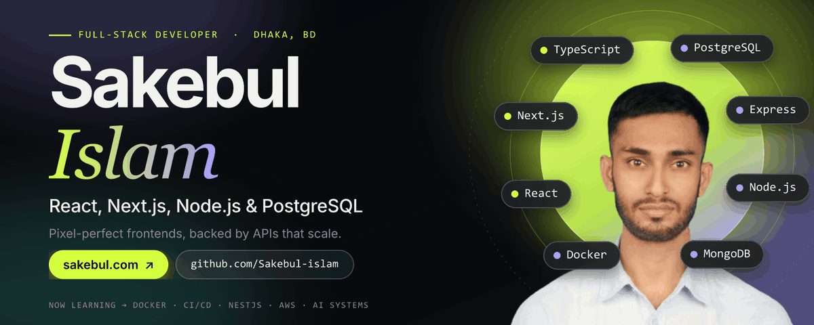

 

## 👋 About me

Hi, I'm **Sakebul** — a developer from Dhaka, Bangladesh who builds fast, thoughtful web products. I work mostly with **React & Next.js**, and I've shipped full-stack MERN apps end to end: authentication, Stripe payments, role-based dashboards and REST APIs.

- 🎯 Pixel-perfect, animated frontends — backed by APIs that scale
- 🌱 **Now learning:** Docker · CI/CD · NestJS · AWS · AI systems (LLM apps, RAG)
- 🧰 **Working with:** TypeScript · Node.js · Express · PostgreSQL · MongoDB
- 📫 **Reach me:** [mdsakebul66@gmail.com](mailto:mdsakebul66@gmail.com) · [sakebul.com](https://sakebul.com)

## 🚀 Featured projects

| Project | What it is | Stack | Links |
| --- | --- | --- | --- |
| **SkillUP** | Online learning platform with Stripe course payments, teacher onboarding, assignments and three role-based dashboards | React · Node · Express · MongoDB · Stripe | [Live](https://skillup-66.netlify.app/) · [Client](https://github.com/Sakebul-islam/SkillUP) · [Server](https://github.com/Sakebul-islam/skillup-server-side) |
| **Kola** | Community food-donation platform connecting donors with people in need | React · Node · Express · MongoDB · Firebase | [Live](https://kola-sakib.netlify.app/) · [Client](https://github.com/Sakebul-islam/Kola) · [Server](https://github.com/Sakebul-islam/kola-server-side) |
| **Martaxo** | Electronics marketplace with brand browsing, reviews and live inventory | React · Node · Express · MongoDB · Firebase | [Live](https://martaxo.netlify.app/) · [Client](https://github.com/Sakebul-islam/Martaxo) · [Server](https://github.com/Sakebul-islam/martaxo-server-side) |

More on [sakebul.com/work](https://sakebul.com/work).

## 🧰 Tech stack

## 📊 GitHub stats

---

**Open to good conversations and good code.** · [sakebul.com](https://sakebul.com)

