

  

  

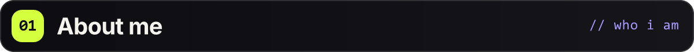

 

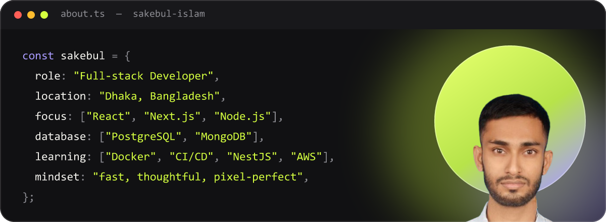

 

> **Hi, I'm Sakebul** 👋 — a developer from **Dhaka, Bangladesh** who builds fast, thoughtful web products.
> I work mostly with **React & Next.js**, and I've shipped full-stack MERN apps end to end — authentication, Stripe payments, role-based dashboards and REST APIs. Right now I'm leveling up on the backend and shipping side: **Docker · CI/CD · NestJS · AWS · AI systems**.

 

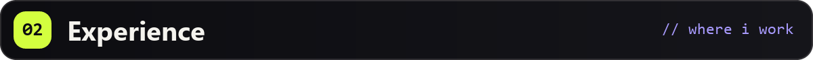

 

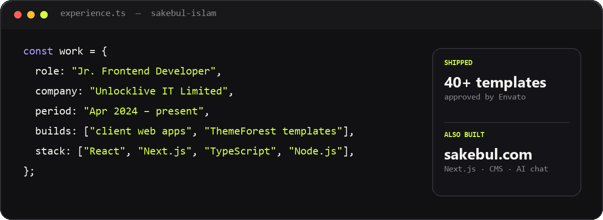

 

> **Jr. Frontend Developer · [Unlocklive IT Limited](https://unlocklive.com)** · Dhaka · Apr 2024 – present
>
> - Build client web apps: Figma designs into responsive React and Next.js interfaces, connected to REST APIs, with Node.js and Express backends when a feature needs one.
> - Shipped **40+ website templates approved by Envato** and sold on ThemeForest, including Averto, Dinevo and SaasLyn.
> - Architect multi-demo Next.js (App Router) templates in React 19 and TypeScript with reusable components and typed content files.
> - Add smooth GSAP, Lenis and Swiper motion while keeping pages fast, SEO-ready and accessible.
>
> **Also built:** [sakebul.com](https://sakebul.com), my full-stack Next.js 16 portfolio with its own CMS, PostgreSQL (Drizzle) and an AI assistant.

 

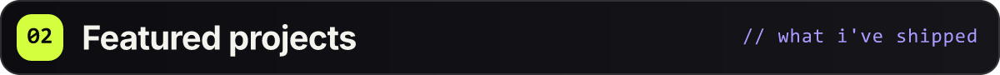

  

<table>
  <tr>
    <td width="33%" align="center" valign="top">
      <a href="https://averto-leanding.vercel.app/">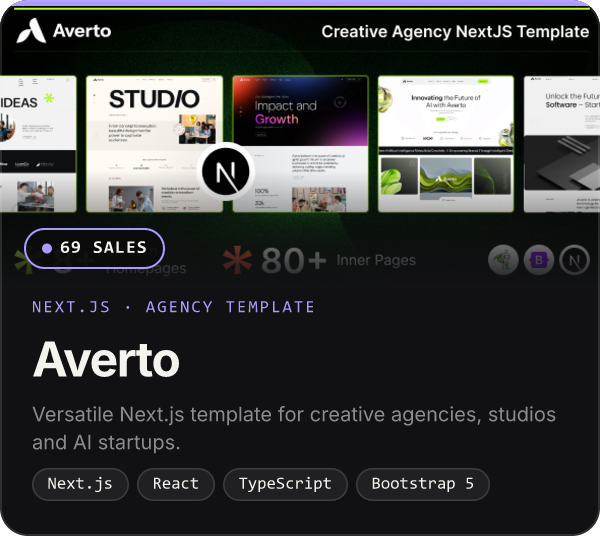</a>
       
      <a href="https://averto-leanding.vercel.app/"><b>▶ Live preview</b></a>
       
      <a href="https://themeforest.net/item/averto-creative-digital-agency-nextjs-template/59342357">ThemeForest</a> · <a href="https://sakebul.com/work/averto-nextjs">Case study</a>
    </td>
    <td width="33%" align="center" valign="top">
      <a href="https://saaslyn-leanding.netlify.app/">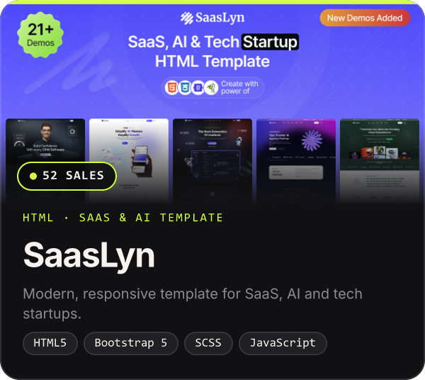</a>
       
      <a href="https://saaslyn-leanding.netlify.app/"><b>▶ Live preview</b></a>
       
      <a href="https://themeforest.net/item/saaslyn-saas-ai-tech-startup-html-template/60544759">ThemeForest</a> · <a href="https://sakebul.com/work/saaslyn-html">Case study</a>
    </td>
    <td width="33%" align="center" valign="top">
      <a href="https://feux-landing-html.netlify.app/">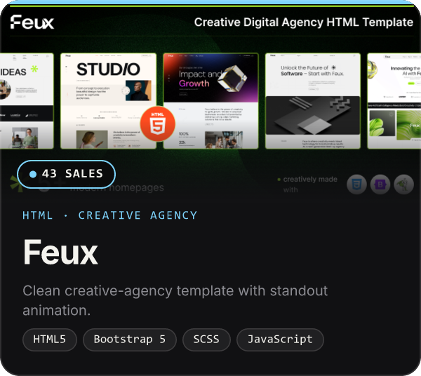</a>
       
      <a href="https://feux-landing-html.netlify.app/"><b>▶ Live preview</b></a>
       
      <a href="https://themeforest.net/item/feux-creative-digital-agency-html-template/56812598">ThemeForest</a> · <a href="https://sakebul.com/work/feux-html">Case study</a>
    </td>
  </tr>
</table>

164 sales across these 3 best-selling ThemeForest templates · 25 projects in all — see <a href="https://sakebul.com/work">sakebul.com/work</a> for more, including web apps like SkillUP, Kola and Martaxo.

  

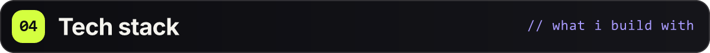

  

<table>
  <tr>
    <td align="right"><b>🎨 Frontend</b></td>
    <td></td>
  </tr>
  <tr>
    <td align="right"><b>⚙️ Backend</b></td>
    <td></td>
  </tr>
  <tr>
    <td align="right"><b>🚢 DevOps</b></td>
    <td></td>
  </tr>
  <tr>
    <td align="right"><b>🧰 Tools</b></td>
    <td></td>
  </tr>
</table>

 

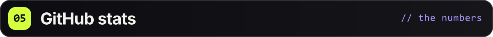

  

  

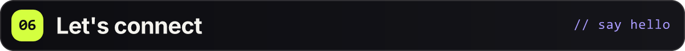

 

<a href="mailto:sakebul@sakebul.com"><b>sakebul@sakebul.com</b></a> &nbsp;·&nbsp; <a href="https://sakebul.com"><b>sakebul.com</b></a>

 

